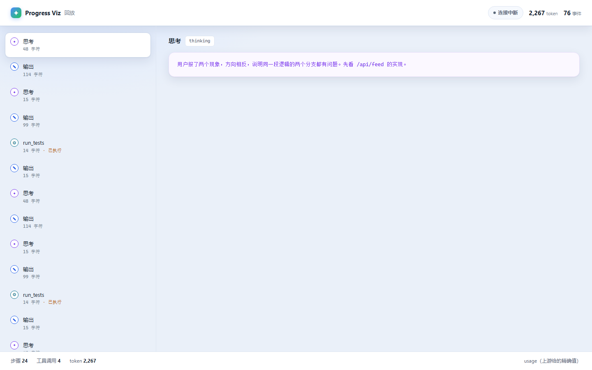

# progressviz

[](https://github.com/xingaorpw/progressviz/actions/workflows/ci.yml)


把 AI 的工作过程变成能看的进度：**每一步在干什么、卡在哪、要不要现在叫停。**



> 一个流式代理 + 一个终端渲染器 + 一个回放界面。零依赖，不改你任何调用代码。

---

## 30 秒上手

不花钱、不需要 API key：

```bash
pip install -e .
python -m progressviz demo
```

````
假上游 http://127.0.0.1:31180
代理   http://127.0.0.1:8792  →  发一个 fake 请求

◆ 思考  用户报了两个现象，方向相反，说明同一段逻辑的两个分支都有问题。先看 /api/feed 的实现。
我先看一下 `server.py` 里 `/api/feed` 的处理逻辑。

问题出在这里：缓存命中时直接返回 `stored[:k]`，完全没考虑 `k` 变大；缓存不足时又生成完整 `k` 条再拼接，导致超过 `k`。

◆ 思考  修法是先算差额，最后统一截断。
改成先补差额、再截断：

```python
need = max(0, k - len(stored))
stored += picks[:need]
return stored[:k]
```
⚙ run_tests
测试通过了，49 个用例全绿。
   token  in 1,840 · out 427 · 合计 2,267
✓ 完成  1 个工具调用 · 2,267 token
````

想看网页版：

```bash
python -m progressviz serve runs/demo.jsonl
# 打开 http://127.0.0.1:8000
```

---

## 它解决什么问题

现在用 AI 做长任务，体验是这样的：

```
[发出指令] ────────────────── 40 秒什么都没有 ────────────────── [一次性吐出结果]
```

这 40 秒里它在干嘛？卡住了还是快好了？方向对不对？只能干等。

而且**等到的往往是错的**。等你看见结果的时候，它已经烧掉几万 token 了。

这个工具做的事很窄：**把这 40 秒摊开给你看，并且允许你在中途叫停。**

---

## 怎么做的

```
[你的程序] --HTTP--> [progressviz proxy] --HTTP--> [模型 API]
                            |
                            +--> 终端渲染（实时）
                            +--> JSONL 落盘（可回放/可分析）
                            +--> Web 回放界面
```

**核心决定：做代理，不做 SDK。**

| | SDK 包装 | 代理 |
|---|---|---|
| 改代码 | 要改 | 改 `base_url` 就行 |
| 支持语言 | 只有一种 | 任何语言、任何客户端 |
| 能看到的东西 | SDK 抽象后的 | 最原始的流 |
| 上游升级挂了 | 等 SDK 跟进 | 一般不受影响 |

代理只做两件事：把字节原样转发，旁边解析 SSE 记事件。

**字节必须原样透传**——客户端拿到的东西，和没装代理时完全一样。这一点有测试守着。

---

## 支持哪些上游

| 上游 | 状态 |
|---|---|
| OpenAI 兼容（`choices[].delta`） | ✅ 测过 |
| DeepSeek（含 `reasoning_content`） | ✅ 测过 |
| Anthropic Messages（`content_block_delta`） | ✅ 测过 |
| 其他 SSE 格式 | ⚠️ 大概率能用，没测过 |

不确定时用 `--provider` 显式指定。

---

## 用法

### 接上真实的模型

```bash
progressviz proxy --upstream https://api.openai.com --store runs/session.jsonl
```

然后把调用方的 `base_url` 指过去，其它什么都不用改：

```python
from openai import OpenAI

client = OpenAI(base_url="http://127.0.0.1:8787/v1", api_key="sk-...")
resp = client.chat.completions.create(
    model="gpt-4o-mini",
    stream=True,
    messages=[{"role": "user", "content": "修复 /api/feed 的条数 bug"}],
)
for chunk in resp:
    ...  # 你的代码完全不用动
```

代理把字节原样转给客户端，同时在终端打印：

```
◆ 思考  用户报了两个现象，方向相反，说明同一段逻辑的两个分支都有问题。
```python
need = max(0, k - len(stored))
```
⚙ run_tests
测试通过了，49 个用例全绿。
   token  in 1,840 · out 427 · 合计 2,267
✓ 完成  1 个工具调用 · 2,267 token
```

### 事后回放

```bash
progressviz render runs/session.jsonl        # 终端重放
progressviz serve  runs/session.jsonl        # 浏览器回放 http://127.0.0.1:8000
progressviz summary runs/session.jsonl       # 只出统计
```

### 全部命令

```bash
progressviz demo                                    # 零配置演示
progressviz proxy --upstream https://api.openai.com # 启动代理
progressviz render runs/session.jsonl               # 终端重放
progressviz summary runs/session.jsonl              # 统计
progressviz serve runs/session.jsonl --port 8000    # Web 回放
```

---

## 事件格式

一行一个 JSON，追加写。崩溃只丢最后一行。

```json
{"seq":1,"ts":"2026-11-06T13:22:41.123+00:00","kind":"thinking","text":"先看 /api/feed","name":"","tokens":12,"meta":{}}
```

| kind | 含义 |
|---|---|
| `thinking` | 推理摘要（注意：是摘要，不是完整思考） |
| `text` | 正文输出 |
| `tool` | 工具调用，`name` 是工具名 |
| `usage` | 上游返回的精确 token，`meta` 里是 input/output |
| `done` | 结束，`meta.estimated` 是没有 usage 时的估算值 |
| `error` | 代理或上游出错 |

---

## 实测输出

`python -m progressviz summary runs/demo.jsonl`：

```json
{
  "events": 19,
  "tokens": 2267,
  "tokens_source": "usage",
  "duration_s": 1.22,
  "by_kind": {
    "start": 1, "thinking": 3, "text": 12,
    "tool": 1, "usage": 1, "done": 1
  }
}
```

`tokens_source` 很关键：

- `usage` —— 上游真的返回了 token 数，可信
- `estimate` —— 上游没给，按「中文 1.5 字/token、英文 4 字符/token」粗估
- `unknown` —— 连估算都没有

**估算值只用来显示，不能用来记账。** 界面上也会标出来。

---

## 关于 token 成本

这个工具本身几乎不花 token。原因很简单：

> 模型是流式输出的，你看到的 token 早就产生了、早就计费了。
> 你现在觉得"它一次性吐结果"，是客户端把流缓存住了。

所以拦截层解析已经到达的数据，**额外成本是 0**。

真正会烧钱的是另一种设计：让模型把想过的东西再复述一遍给你看。

| 方案 | 相对成本 |
|---|---|
| 观察流（本项目） | **0** |
| 让模型自述进度 | +24%（输出留在历史里，会复利） |
| 进度回注到 prompt 末尾 | +9.6% token，等效成本 +52% |
| 进度回注到 prompt 中间 | 等效成本 **5×**（击穿前缀缓存） |

推导过程：假设 20 轮任务、起始上下文 2000、每轮工具返回 500、模型输出 400，
prompt cache 命中部分按 10% 计价。改参数重算很快。

---

## 已知限制

这些不是"待优化"，是当前版本就做不到：

- **看不到完整思考过程。** 上游只给推理摘要，拿不到内部计划。UI 上也标了。
- **Web 只做回放，不做实时。** 实时看请用终端渲染器。做实时 Web 需要常驻服务 + 鉴权，超出 v0.1 范围。
- **不支持 WebSocket 上游。** 只处理 HTTP SSE。
- **没有鉴权。** 默认绑 `127.0.0.1`，别暴露到公网。
- **token 估算很粗。** 只在没有 `usage` 时兜底。
- **非流式请求不产生事件。** `stream=false` 时拿不到分片。

---

## 跑测试

```bash
python -m unittest discover -s tests -t . -v
```

51 个用例：

| 文件 | 覆盖 |
|---|---|
| `test_events.py` | SSE 切块、JSON 容错、两家归一化、usage 提取、token 估算 |
| `test_store.py` | JSONL 读写、坏行跳过、统计与回退、时长计算 |
| `test_proxy.py` | **真起假上游 + 真走 HTTP**：字节透传、事件顺序、usage 精确值、502 处理 |
| `test_web.py` | 首页、summary、SSE 流、404 |

CI 在 Ubuntu 和 Windows 上跑 Python 3.9 和 3.12，外加一个端到端冒烟任务。

---

## 设计原型与工具

- **[`design/`](design/)** —— 单文件 UI 原型（`prototype.html`），演示了两个还没进产品的交互：
  **失败拦截**（失败那一刻停下来问你要不要继续）和**成本归因**（跑完告诉你钱花在哪）。
  它是设计探索，不读真实事件。
- **[`tools/estimate_tokens.py`](tools/estimate_tokens.py)** —— 上面那张 token 成本对比表的推导脚本，
  改参数就能按你自己的轮数和上下文重算。

## 可以继续做的方向

- 实时 Web 视图（需要鉴权和会话管理）
- 支持更多上游（Gemini、Bedrock、自建推理）
- 在 `tool` 事件里带上参数和返回，现在只有工具名
- 把一次运行的 token 按步骤归因，直接回答"钱花在哪"
- 中途注入指令并重跑（这是最有价值也最难的一个）

---

## License

[MIT](LICENSE) © 2026 xingaorpw
